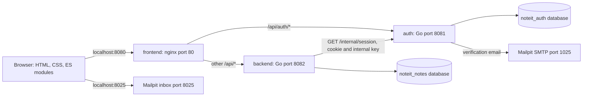

# NoteIt architecture

This guide describes the code in this repository as inspected on 2026-10-13, starting from commit `503becd`. It distinguishes implemented behavior from limitations and possible extension points. It is a source analysis; it does not claim that the Compose deployment has been exercised live.

Read this overview first, then the [frontend guide](frontend-architecture.md), [backend guide](backend-architecture.md), and [operations and testing guide](operations.md). The existing [API reference](api.md) gives request and response examples.

## 1. What the application is

NoteIt is a text notebook with verified email accounts, automatic saving, tags, search, pinning, archive, Trash, and read-only publication links. A publication displays the current saved note rather than a frozen snapshot. Editing is restricted to the owner; there is no collaborative editor.

The application consists of a browser UI, an nginx ingress, two independently running Go services, one PostgreSQL server containing two databases, and Mailpit for local verification email. There is no frontend framework, bundler, ORM, message broker, Redis, object storage, or vector service.

## 2. Runtime topology



`noteit_auth` and `noteit_notes` are hosted by the same `postgres:17-alpine` container. This is a shared database server with separate logical databases and credentials, not two PostgreSQL containers. The frontend service serves assets and proxies requests; application rendering happens in the browser.

| Component | Responsibility | Source |
| --- | --- | --- |
| Browser | Views, editor, drafts, autosave, Markdown preview, sharing dialog | [`web/`](../web/) |
| nginx | Static delivery, same-origin API routing, security headers | [`deploy/nginx.conf`](../deploy/nginx.conf) |
| Auth service | Registration, verification, passwords, sessions, email | [`internal/auth/`](../internal/auth/) |
| Notes service | Owner-scoped notes, search, tags, state changes, publications | [`internal/notes/`](../internal/notes/) |
| Shared Go package | Configuration, HTTP helpers, migration runner, DB pools | [`internal/platform/platform.go`](../internal/platform/platform.go) |
| PostgreSQL | Durable records, integrity constraints, full-text index | Both services' `migrations/` directories |
| Mailpit | Receives local SMTP messages and exposes a test inbox | [`compose.yaml`](../compose.yaml) |

Only frontend and Mailpit expose host ports, bound to `127.0.0.1`. Auth, backend, PostgreSQL, and SMTP remain on the Compose network. The Compose configuration is a local deployment, with HTTP ingress and unencrypted database connections inside that network.

## 3. Code organization and dependency direction

```text
cmd/auth/main.go       ──▶ internal/auth     ──▶ internal/platform
cmd/backend/main.go    ──▶ internal/notes    ──▶ internal/platform
                              │
                              └── HTTP ──▶ auth /internal/session

web/app.js             ──▶ web/autosave.mjs
                       └─▶ web/markdown.mjs
                       └─▶ same-origin JSON API through nginx
```

The Go entry points assemble concrete dependencies. `auth.Server` receives a PostgreSQL pool and a `Mailer`; `notes.Server` receives a PostgreSQL pool and an `Authenticator`. Interfaces permit test substitutes without making production packages depend on the integration suite.

Handlers contain validation, authorization, SQL, and response construction. There is no separate controller/service/repository hierarchy. `internal/notes/model.go` defines the returned model, column scanning, and field normalization; it is not an ORM. Browser state is a single module-level object and values in DOM controls.

## 4. Data ownership and trust boundaries

Auth owns `users`, `sessions`, and `verification_tokens`. Notes owns `notes`, with tags and publication settings stored in arrays/columns on each note. Each database also has `schema_migrations`.

`notes.owner_id` is the UUID returned by auth, but has no foreign key to `users`: PostgreSQL foreign keys cannot enforce this relationship across these separate databases. The notes service never queries account tables. Account deletion and cross-service cleanup are not implemented.

The browser receives an opaque `noteit_session` cookie. Its `HttpOnly` flag prevents JavaScript from reading the session token. The browser sends it automatically to same-origin requests. The backend forwards only that cookie and `X-Internal-Key` to auth; auth returns `{id, email}` for a valid, unexpired, verified account. Backend authorization trusts this authenticated service response.

The internal key is a service credential, not a user identity. The nginx proxy clears client-supplied `X-Internal-Key` and blocks `/internal/`. Both service entry points require a key of at least 32 characters. Access to backend/auth must remain controlled because auth's rate limiter trusts nginx's overwritten `X-Real-IP` header.

## 5. Account lifecycle

```mermaid
sequenceDiagram
    participant B as Browser
    participant A as Auth through nginx
    participant D as Auth database
    participant M as Mailpit or SMTP
    B->>A: POST /api/auth/register
    A->>A: Normalize email and hash password
    A->>D: Begin transaction, insert unverified user and token hash
    A->>M: Send /#verify=token link before commit
    M-->>A: SMTP DATA acknowledgement
    A->>D: Commit
    A-->>B: 202 generic verification message
    B->>B: Open email link and choose Verify email
    B->>A: POST /api/auth/verify
    A->>D: Lock user, consume unexpired token, mark verified
    A-->>B: 200; no session created
    B->>A: POST /api/auth/login
    A->>D: Check password/verification; insert session hash
    A-->>B: User and HttpOnly cookie
```

Verification tokens expire after 30 minutes and can be consumed once. Sessions expire after seven days; requests do not renew them. Logout deletes the current session and expires the cookie. Other sessions for the same account remain valid.

Sending verification email inside the database transaction permits rollback on SMTP failure. It also ties transaction duration to email latency. SMTP delivery and PostgreSQL commit are separate systems: if email is accepted but commit fails, a delivered link can be unusable. There is no durable email outbox or background delivery queue.

## 6. Editing and consistency

On input, the frontend captures title/content/tags, preserves a browser draft, and schedules autosave after 650 ms. A save sends a PATCH with the last acknowledged `version`. One autosave request runs at a time per editor; newer input accumulates while it runs.

Every successful note mutation advances `version`, including pin/archive, Trash/restore, publication settings, and even a version-only PATCH. SQL updates require a matching owner, version, and valid state. Two requests with the same version cannot both update the row successfully.

```mermaid
sequenceDiagram
    participant E as Editor and Autosave
    participant N as Notes through nginx
    participant A as Auth
    participant D as Notes database
    E->>E: Input; persist draft; wait 650 ms
    E->>N: PATCH note with version V
    N->>A: Validate session via internal HTTP
    A-->>N: Verified user identity
    N->>D: UPDATE WHERE owner_id and version=V and not deleted
    alt Update succeeds
        D-->>N: Complete note, version V+1
        N-->>E: 200 complete note
        E->>E: Update version; clear draft if no pending input
    else Row did not match
        N->>D: Fetch current note scoped to owner
        N-->>E: 409 with current note, or 404 if unavailable
        E->>E: Preserve draft and block autosave on 409
    end
```

The conflict UI offers draft download and loading the server version. It does not merge changes or retry automatically with a new version. Loading the server version discards the stored local draft. There is no revision history, undo API, WebSocket synchronization, or cross-tab notification mechanism.

## 7. Note state and publication lifecycle

```mermaid
stateDiagram-v2
    [*] --> Active: create, version 1
    Active --> Archived: PATCH archived=true; revoke link
    Archived --> Active: PATCH archived=false
    Active --> Trash: DELETE; unpin and revoke link
    Archived --> Trash: DELETE; unpin and revoke link
    Trash --> Active: POST restore; clear archived
```



Pinning and publication are separate properties rather than lifecycle states. Archived notes can still be edited through the UI/API, but cannot be published. Trash notes remain readable by their owner and cannot be edited. Restore returns a note to active without republishing or repinning it.

`visibility='private'` alone does not tell whether a note has a publication: a private note can have an owner-only share URL. `share_token IS NULL` means there is no live link. Publishing retains an existing token, while revocation, archiving, or deleting clears it. Republishing after revocation generates a new random token.

Public links bypass session authentication in the notes API. Private links require the owner; restricted links allow the owner plus verified accounts matching `allowed_emails`. Unauthorized signed-in readers receive 404; anonymous private/restricted readers receive 401. Returned publications contain only title, content, and update time.

Access is evaluated for each request. Already rendered pages do not refresh automatically, and a concurrent change does not cancel an in-flight response or retract text already received. The shared-page browser bootstrap still calls `/api/auth/me` before requesting the published note, even when its API is public.

## 8. Search and read behavior

PostgreSQL maintains a generated `tsvector` over title/content using the `simple` configuration, with title weight A and content weight B. Queries combine full-text matching, literal case-insensitive title/tag substring matching, an optional exact tag, folder state, and optional pinned filtering. Results are sorted by pin status and update time, not search rank.

The API defaults to 50 notes per page; the UI explicitly requests 30. Lists return a 180-character excerpt and empty content, so the editor always fetches a complete note. The count and page are separate SQL statements and are not a consistent snapshot. The frontend discards stale list responses using an increasing request number.

Tags are normalized and deduplicated per note. Tag counts cover all non-deleted notes, including archive, regardless of the current folder/search filter.

## 9. Security model

| Layer | Implemented protection | Boundary or limitation |
| --- | --- | --- |
| Credentials | Salted PBKDF2-SHA256; opaque random tokens; stored session/verification hashes | No password reset, MFA, or account management |
| Sessions | HttpOnly, SameSite=Lax, Secure when APP_URL is HTTPS | Local default is HTTP; no session refresh |
| Browser mutations | Origin equality and cross-site fetch rejection | Requests without browser origin metadata are accepted; this is not per-request CSRF-token validation |
| Service boundary | Shared internal key and non-public auth/backend ports | Backend identity checks require auth availability |
| Note access | Owner conditions in all owner SQL; publication-specific checks | No cross-database owner FK or PostgreSQL row-level security |
| Input | Parameterized SQL, explicit limits, JSON object validation and unknown-field rejection | Default Go mux errors and nginx errors may not be JSON |
| Rendered text | Escaping, allowed link schemes, image-to-alt-text rendering | Markdown is a custom subset, not a complete CommonMark parser |
| Browser policy | CSP, frame denial, no-referrer, nosniff, no-store | No service worker/offline app shell |
| Runtime | Go containers are unprivileged, read-only, no capabilities | Frontend/PostgreSQL/Mailpit do not share all those restrictions |

Drafts are plaintext in origin-scoped localStorage, separated by account/note key. They are not encrypted and are not durable server backups. No credentials from `.env` are needed to understand the architecture; documentation uses only configuration names and defaults.

## 10. Operational characteristics and extension points

There is one auth instance and one backend instance in Compose. Each service has a maximum of ten PostgreSQL connections. Autosave success refreshes both notes and tags, causing extra database work and session checks. Authentication uses an HTTP lookup per protected request with no cache. The application therefore prioritizes straightforward isolation and immediate session revocation over reducing request round trips.

Health checks verify each Go service's own database, not all downstream functionality. Auth health does not check SMTP; backend health does not call auth; nginx health is a constant response. Runtime failures can therefore occur while all health endpoints return success.

There is no background note purge, share invitation sender, audit log, metrics endpoint, request tracing, or backup job. The auth cleanup goroutine removes expired sessions and verification tokens on startup and hourly.

To extend the application, use these ownership boundaries:

| Change | Starting points | Related behavior to preserve |
| --- | --- | --- |
| New note field | Notes migration, model scanning, create/update SQL, API reference, editor | Versions, owner checks, summaries, publication field exposure |
| New note action | Notes route and state predicate, frontend `mutate()` | Flush edits first; version advancement; conflict response |
| Auth capability | Auth handler/schema, browser auth flow | Generic responses, verified-session identity, cookie handling |
| Richer text preview | `web/markdown.mjs`, renderer tests, CSP | Escaped HTML, safe links, text-only product restrictions |
| Search behavior | Generated index migration and `list()` SQL | Per-owner filtering and consistent filter semantics |
| More auth replicas | Deployment plus limiter implementation | Shared rate limiting; migration serialization; identical internal key |

These are navigation aids, not implemented roadmap items. The detailed guides include function maps, schema constraints, timeouts, operational commands, and known implementation edges.
