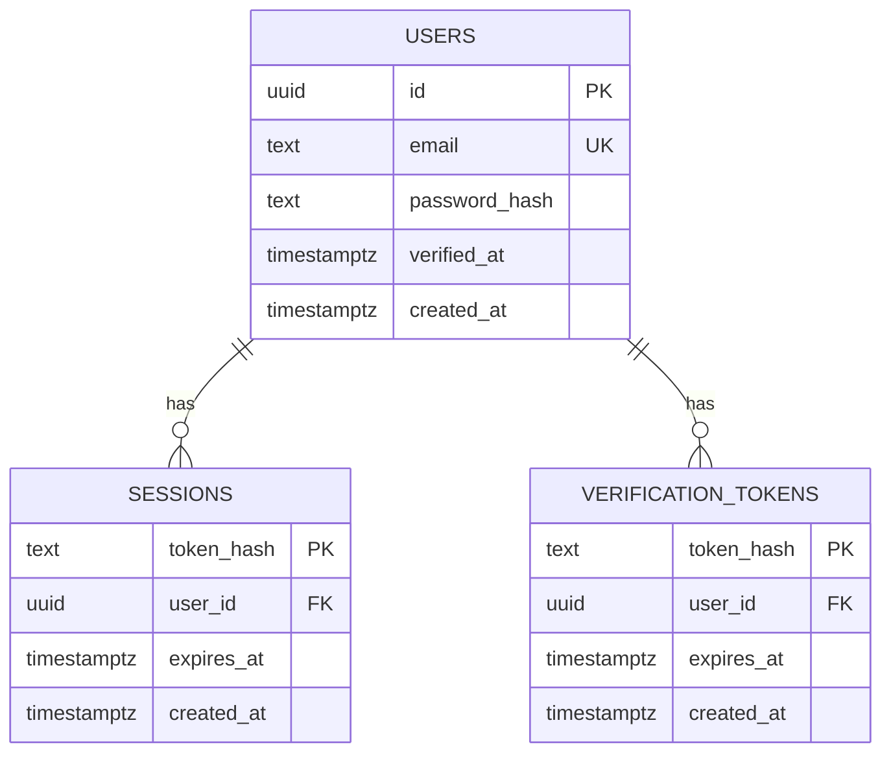

# Backend architecture

This guide covers the two Go services, their database models, and shared infrastructure. See the [overview](architecture.md), [frontend guide](frontend-architecture.md), and [API reference](api.md) for the other parts of the application.

## 1. Packages and construction

| File/package | Role |
| --- | --- |
| [`cmd/auth/main.go`](../cmd/auth/main.go) | Build auth dependencies, open auth DB, start cleanup and HTTP server |
| [`cmd/backend/main.go`](../cmd/backend/main.go) | Build notes dependencies, open notes DB, configure HTTP auth client |
| [`internal/platform/platform.go`](../internal/platform/platform.go) | Shared configuration, token/email helpers, JSON, middleware, DB/migrations, HTTP lifecycle |
| [`internal/auth/server.go`](../internal/auth/server.go) | Auth routing and lifecycle handlers |
| [`internal/auth/password.go`](../internal/auth/password.go) | Password hash generation/checking |
| [`internal/auth/limiter.go`](../internal/auth/limiter.go) | Shared per-IP auth-attempt limiter |
| [`internal/auth/mail.go`](../internal/auth/mail.go) | Mailer interface and SMTP delivery |
| [`internal/notes/server.go`](../internal/notes/server.go) | Notes routing, SQL operations, state rules, publication reads |
| [`internal/notes/model.go`](../internal/notes/model.go) | Note response model, scanning, text/tag/access validation |
| [`internal/notes/auth.go`](../internal/notes/auth.go) | Authenticator interface and internal HTTP implementation |

`go.mod` declares Go 1.26.0 and `github.com/jackc/pgx/v5 v5.8.0`. Other modules are indirect dependencies. HTTP routing, cryptography, logging, and SMTP use the Go standard library. There is no external HTTP framework or ORM.

Each service starts by opening its required `DATABASE_URL` with a 30-second initialization context and embedded migrations. Failure logs an error and exits. It then validates `INTERNAL_API_KEY` (minimum 32 characters) and `APP_URL`. Auth validates the sender email and builds SMTPMailer, starts a cancellable cleanup goroutine, and listens on `:8081` by default. Backend builds AuthClient with a four-second HTTP client timeout and listens on `:8082`. `LISTEN_ADDR` can override each process's default outside the fixed Compose wiring.

`Server.Handler()` builds a method/path-aware `http.ServeMux` and wraps it in shared middleware. GET routes also follow Go mux HEAD matching behavior. Unknown routes and wrong methods use the standard mux responses, which may be plain text rather than application JSON.

## 2. Common request pipeline

```text
nginx security/routing rules
  → platform.Middleware
    → http.ServeMux
      → auth limiter (four auth POST routes), or notes owner wrapper
        → handler validation
          → parameterized PostgreSQL operation / external dependency
            → JSON result or error
```

Middleware applies `Cache-Control: no-store`, `X-Content-Type-Options: nosniff`, and `Referrer-Policy: no-referrer`. It recovers handler panics and attempts a generic 500 response while logging the panic. It is not request/access logging middleware.

For methods other than GET/HEAD/OPTIONS, a nonempty Origin must equal the configured application origin, and `Sec-Fetch-Site: cross-site` is rejected. Originless non-browser clients remain usable. There is no permissive CORS layer or CSRF-token table; browser requests go through the same origin.

### JSON handling

`Decode()` requires media type `application/json` (parameters such as charset are allowed), limits request bodies to 1 MiB, accepts exactly one top-level JSON object, and rejects unknown struct fields. Arrays, null, malformed data, trailing JSON values, and oversize bodies are rejected. It uses Go's JSON decoder rather than a schema-validation library; duplicate known keys are not explicitly rejected.

`JSON()` sets JSON Content-Type and serializes the value. `Error()` emits `{error: message}`. `InternalError()` logs the actual error and returns a generic 500 message. The standard mux, nginx body-limit failures, and proxy failures can have different response formats.

### Shared identity and token helpers

`platform.User` contains only ID/email. `Email()` lowercases/trims input, parses it as an address, rejects display-name forms, requires `@`, and imposes a 254-byte limit. `Token()` generates 32 cryptographically random bytes encoded as 64 lowercase hex characters. `ValidToken()` checks length and hex decoding (either hex case is syntactically accepted); `Hash()` is SHA-256 encoded as hex. Actual generated links/tokens use lowercase.

## 3. PostgreSQL connection and migration architecture

`OpenDB()` parses a pgx pool configuration, caps `MaxConns` at ten, sets PostgreSQL `statement_timeout=10000` ms, creates the pool, pings it, and applies migrations. Failed ping/migrations close the pool. No connection retry loop is present in startup code; Compose health ordering and container restart policy provide deployment-level retries.

Both packages embed `migrations/*.sql` into their binaries. The runner starts a transaction, acquires advisory transaction lock `71626371`, creates `schema_migrations` if needed, and reads SQL files in filename order. Applied filenames are skipped. A new file is executed and its name inserted; all new migrations commit together, or roll back on failure.

Use zero-padded numbered filenames. Previously applied file contents are not checked against a checksum, so editing an applied migration does not rerun it or detect drift. There is no down-migration runner or schema-version API. Startup migration requires a role allowed to create/alter its owned schema.

Both databases have:

| `schema_migrations` column | Definition |
| --- | --- |
| `name` | text primary key; SQL filename |
| `applied_at` | non-null timestamptz, defaults to now |

The [database initialization script](../deploy/init-db.sh) creates one owner role per database, revokes PUBLIC connect, and grants each owner its own connect permission. The PostgreSQL administrator still controls both databases. Initialization scripts run only when the PostgreSQL data directory is first initialized.

## 4. Auth database schema

Source: [`internal/auth/migrations/001_initial.sql`](../internal/auth/migrations/001_initial.sql).



`users.id` defaults to `gen_random_uuid()`. Email is unique, non-null, and checked to be lowercase. Password hash is non-null. A null `verified_at` means unverified; creation time defaults to now. Sessions and verification tokens reference users with cascading deletion. Both token tables index `user_id` and `expires_at` for lookup/cleanup. Expiry and creation fields are non-null; token creation time defaults to now.

Session/verification tokens are hashed before storage. Publication tokens, described below, are instead stored directly because the server must reconstruct their share URLs. There is no encryption-at-rest implementation in application code.

## 5. Authentication handlers

| Route | Handler | Main database/dependency work |
| --- | --- | --- |
| POST `/api/auth/register` | `register` | Create unverified user and send token inside transaction |
| POST `/api/auth/resend-verification` | `resend` | Lock unverified user; cooldown; rotate/send token |
| POST `/api/auth/verify` | `verify` | Lock user; consume unexpired token; set verification |
| POST `/api/auth/login` | `login` | Password and verification checks; create session |
| GET `/api/auth/me` | `me` / `session` | Join session to verified user |
| GET `/internal/session` | `internalSession` / `me` | Constant-time internal key check, then session lookup |
| POST `/api/auth/logout` | `logout` | Delete current session hash, expire cookie |
| GET `/healthz` | `platform.Health` | Ping auth database |

### Registration

Decode credentials; validate normalized email; require at least 12 Unicode code points and at most 128 password bytes. Generate a password hash before starting the transaction. Insert with `ON CONFLICT(email) DO NOTHING`. An existing address returns the same generic 202 message without replacing its password or sending a new verification token.

For a new user, `sendToken()` deletes that user's prior verification tokens, inserts a hash expiring in 30 minutes, and sends `${APP_URL}/#verify=${token}`. SMTP failure returns 503 and the deferred rollback removes the new account/token. Commit failure returns 500. Registration does not create a session.

### Resend and verification concurrency

Resend selects an unverified user `FOR UPDATE`. Missing/verified users receive the generic 202. Any verification token created in the last minute suppresses sending, again with the generic response. Otherwise it rotates the token and sends before commit. Sending failure rolls back token rotation.

Verify rejects syntactically invalid tokens, then joins an unexpired matching token to an unverified user and locks the user first. This matches resend's user-first lock order. It deletes the still-unexpired token and requires exactly one affected row, marks the user verified, deletes remaining user tokens, and commits. Reuse/expiry/missing tokens return 400. An email link does not verify automatically on GET; the browser makes an explicit POST.

### Passwords and login

`HashPassword()` generates a 16-byte random salt and derives a 32-byte PBKDF2-HMAC-SHA256 key with 600,000 iterations. Encoding is `pbkdf2-sha256$iterations$salt-hex$key-hex`. `CheckPassword()` validates the encoding, 16/32-byte salt/key lengths, and iteration range 100,000–2,000,000, then compares in constant time.

`Handler()` precomputes a dummy hash. A missing user's login checks this hash to incur password-hash work before returning the generic 401. A correct password for an unverified user returns 403. Verified login inserts a fresh session hash expiring after seven days and returns user ID/email plus the cookie.

Cookie attributes are `Path=/`, HttpOnly, SameSite=Lax, Max-Age seven days, and Secure only when APP_URL starts with `https://`. No Domain attribute is set. Session lookup checks token syntax, database expiry, and verified account state. There is no sliding expiration, JWT verification, or session identity cache.

Logout requires an empty JSON object (unknown fields are rejected), deletes the hash of a supplied cookie if present, and emits a deletion cookie with Max-Age -1. It can succeed without a valid session; origin middleware and JSON requirements still apply.

### Rate limiting and cleanup

One mutex-protected limiter created per Handler is shared by register/login/verify/resend. It uses X-Real-IP (or RemoteAddr fallback), a fixed one-minute window beginning on first counted attempt, and at most 20 attempts per IP. Invalid input counts too. It scans/removes expired buckets on every wrapped request; there is no separate cleanup timer. A full 10,000-bucket map causes all attempts to be denied until buckets expire, including existing IPs, because the capacity condition applies globally. Rejections return 429 and `Retry-After: 60`.

The limiter is process-local and resets on restart. It does not protect logout/me/internal session or notes routes. Proxies ahead of nginx may affect the actual IP nginx sees; this configuration uses `$remote_addr` rather than a forwarded client-IP chain.

`Cleanup()` runs immediately and hourly, deleting expired sessions and verification tokens. It logs errors and stops when its context is canceled. Expired records are already unusable before cleanup because request queries enforce expiry.

## 6. SMTP delivery implementation

The `Mailer` interface has one method, `SendVerification(context, email, link)`. Production uses SMTPMailer; integration tests use an in-memory inbox.

SMTPMailer connects with a five-second dial timeout and sets a ten-second connection deadline. If STARTTLS is advertised, it upgrades using hostname validation and TLS 1.2 minimum. If STARTTLS is unavailable and `RequireTLS` or a username is set, sending fails. With a username, it authenticates using SMTP PLAIN after the TLS check.

It sends a plain UTF-8 text message using MAIL, RCPT, and DATA. Successful DATA close is treated as delivery handoff; failed QUIT does not invalidate the token. This acknowledges acceptance by the SMTP server, not final receipt by a person's inbox. Implicit TLS on port 465, HTML emails, attachments, and queue/retry delivery are absent.

## 7. Backend authentication and ownership

`notes.Authenticator` accepts an HTTP request and returns `platform.User` or an error. Production AuthClient checks for a syntactically valid session cookie before any network call, makes a GET to `${AUTH_URL}/internal/session`, forwards that cookie, and sets `X-Internal-Key`. Its request context has a three-second timeout; the entry point also supplies a four-second client timeout.

Auth status 401 maps to `ErrUnauthorized`. Other non-200 statuses, transport errors, malformed JSON, or incomplete identity return errors. The notes owner wrapper maps unauthorized to 401 and auth failures to 503, then validates any note ID against a UUID-format regex (invalid IDs return 404). Owner-scoped SQL remains essential: possessing a syntactically valid ID grants no access.

There is no lookup cache; every protected notes/tags request authenticates independently. Public publication reads are the exception. An internal-key mismatch also produces 401 from auth and is therefore classified as unauthorized by AuthClient rather than as an explicit configuration error.

## 8. Notes database schema and response model

Source: [`internal/notes/migrations/001_initial.sql`](../internal/notes/migrations/001_initial.sql) and [`model.go`](../internal/notes/model.go).

| Column | Type/default | Meaning and constraints |
| --- | --- | --- |
| `id` | uuid PK, generated | Note identifier |
| `owner_id` | uuid, non-null | Auth user identity; no cross-database FK |
| `title` | text, empty | Non-null; at most 200 PostgreSQL characters |
| `content` | text, empty | Non-null; at most 200,000 bytes |
| `tags` | text[], empty | Non-null; at most 20 elements |
| `pinned` | boolean, false | Non-null; first in list order |
| `archived` | boolean, false | Non-null; separate from Trash flag |
| `deleted_at` | nullable timestamptz | Non-null value indicates Trash |
| `version` | bigint, 1 | Non-null; positive, advanced by mutations |
| `visibility` | text, private | Non-null; private/restricted/public only |
| `share_token` | nullable unique text | Token for current live link |
| `allowed_emails` | text[], empty | Non-null; at most 50; must be empty outside restricted mode |
| `created_at` | timestamptz, now | Non-null creation timestamp |
| `updated_at` | timestamptz, now | Non-null; handlers explicitly advance it |
| `search_document` | stored generated tsvector | Weighted simple title/content tokens |

Non-private visibility requires a share token. The database does not enforce every application rule, such as tag normalization, email syntax, or publication revocation on archive/delete; handlers enforce those. There are no triggers automatically incrementing versions/update time, so direct SQL writes bypass that behavior unless explicitly reproduced.

Indexes: a B-tree on `(owner_id, pinned DESC, updated_at DESC, id)` for listing; GIN on search_document; GIN on tags; primary-key and unique share-token indexes. Substring title/tag searches are not backed by a dedicated trigram index.

The JSON Note model omits owner_id and raw share_token. `scan()` derives `share_url` from BaseURL plus `/s/{token}`. Complete notes include editing/publication metadata and arrays. Summary scanning selects empty content plus `left(content,180)` as excerpt; other metadata, including the owner's allowed_emails/share_url, remains in summaries. Empty excerpts may be omitted via `omitempty`.

### Validation

Text must be valid UTF-8 without NUL. Titles allow at most 200 code points; content allows 200,000 UTF-8 bytes. There is no Markdown validation or HTML stripping: text is stored literally and rendered safely by the browser.

Tags are capped at 20 input elements before filtering/deduplication, trimmed/lowercased, empty entries dropped, and unique values retained in first-seen order. Tags allow at most 40 code points and no Unicode control characters.

Visibility is checked against three values. Restricted email lists allow at most 50 input elements before deduplication; addresses are normalized by platform.Email and preserved in first-seen order. Private/public lists are immediately cleared, so invalid unused email entries are not validated in those modes.

## 9. Reads, search, and tags

| Route | Handler | Behavior |
| --- | --- | --- |
| GET `/api/notes` | `list` | Owner-only paginated summaries and total |
| GET `/api/tags` | `tags` | Owner's non-deleted tag counts |
| GET `/api/notes/{id}` | `get` | Complete owner note, including archive/Trash |

List defaults are `state=active`, limit 50, offset 0. States are active (not deleted, not archived), archived (not deleted, archived), and trash (deleted regardless of archived). Search is trimmed and capped at 200 bytes. Limit allows 1–100, offset 0–100,000, and optional pinned accepts only true/false.

The WHERE expression ANDs owner/state, search match, exact tag containment, and optional pin status. Search itself ORs:

- `search_document @@ websearch_to_tsquery('simple', q)` for title/content lexical matching.
- `strpos(lower(title), lower(q)) > 0` for literal title substring.
- Any normalized tag containing lowercased q.

The `simple` text-search configuration does not perform English stemming. Title/content weights are stored but no rank function is used. Search results remain ordered pinned descending, updated_at descending, ID ascending. Full-text and substring clauses have different matching semantics; content has no literal substring fallback.

Count and page execute separately using the same parameters, without a surrounding transaction. Concurrent changes can produce a total/page mismatch. Tag counts unnest arrays laterally, group per tag, and sort alphabetically; archive is included, Trash excluded, and the current UI filter is irrelevant.

## 10. Writes and optimistic concurrency

Create decodes optional title/content/tags, validates and normalizes them, and inserts owner plus fields. Schema defaults provide version 1, active/unpinned/private state, timestamps, and no link. It returns 201 and the complete note.

PATCH decodes a positive version and pointer fields for title/content/tags/pinned/archived. Omitted or null pointer fields leave stored values unchanged through SQL `coalesce`; empty strings clear text, empty arrays clear tags, and false explicitly clears booleans. Text validation examines supplied values; stored unchanged text was validated on prior writes.

All mutation SQL includes note ID, owner ID, expected version, and action state predicates, and uses `RETURNING` to get the updated row. Version and updated_at advance atomically. A version-only PATCH still advances both. No explicit transaction is needed around a single compare-and-update statement.

| Handler / route | Required state | Other effects |
| --- | --- | --- |
| `update`, PATCH note | Not deleted | Optional edits/pin/archive; archived=true clears link/allowlist and sets private |
| `trash`, DELETE note | Not deleted | Set deleted_at, unpin, clear link/allowlist, set private; retain archived flag |
| `restore`, POST `/restore` | Deleted | Clear deleted_at and archived; revoked link stays absent; pin remains false |
| `publish`, PUT `/publication` | Not deleted and not archived | Set mode/list, create token if absent, preserve existing token |
| `unpublish`, DELETE `/publication` | Not deleted | Set private, clear list/token; allowed on archived notes too |

`mutationResponse()` handles no-row updates by rereading the note with owner scope. Missing/wrong-owner notes return 404. An existing owner's note returns 409 with its complete current representation, whether caused by stale version or invalid state. The reread is a separate statement, so it can observe another concurrent mutation after the failed update. Other database errors return 500.

`versionInput()` is the common positive-version-only decoder for Trash, restore, and revoke requests. Publishing uses its own body decoder/normalizer.

## 11. Publication reads and access decisions

`shared()` validates the token, loads an active non-deleted note matching share_token, and returns 404 for malformed/missing/revoked links. The API does not reveal whether a nonexistent token used to be valid.

For initial public visibility it returns without contacting auth. For other modes it authenticates, returning 401 for no valid session or 503 for dependency failure, then runs a fresh SQL authorization query checking the note's ID/token/current lifecycle and one of owner ID, public mode, or restricted email membership. This second query catches access changes during the auth lookup. Disallowed signed-in access returns 404.

Successful responses contain only title/content/updated_at from the initial read. This is not one serializable snapshot across the initial read, auth call, and access check. A public read already in flight can finish after revocation; a protected read can return earlier text after its later permission check. Subsequent requests enforce the updated rules. There are no server pushes to retract or update already displayed content.

Private publishing still creates a token; only the owner can use it. Restricted matching uses auth's verified normalized email rather than an invitation record. No invitations are sent, and an allowed email can be added before its account exists. Publishing updates the note row instead of creating a publication table or immutable snapshot.

## 12. HTTP server lifecycle, timeouts, and observability

| Setting | Value |
| --- | --- |
| Service startup DB context | 30 seconds |
| Database statement timeout | 10 seconds |
| Pool max connections | 10 per service |
| ReadHeaderTimeout | 5 seconds |
| ReadTimeout | 15 seconds |
| WriteTimeout | 30 seconds |
| IdleTimeout | 60 seconds |
| MaxHeaderBytes | 16 KiB |
| Graceful shutdown budget | 10 seconds |
| DB health ping context | 2 seconds |
| Internal auth request context/client | 3 / 4 seconds |
| SMTP dial/connection deadline | 5 / 10 seconds |

`Serve()` listens for SIGINT/SIGTERM and calls HTTP Shutdown with a ten-second budget. Pools close when entry points return. Shutdown errors are ignored, and the code does not separately await the shutdown goroutine before returning from Serve. There is no custom force-close path or request cancellation coordinator beyond contexts/server shutdown.

Logging uses `slog` for startup, configuration, request/dependency errors, migration initialization failure, and cleanup failure. No request IDs, latency logs, distributed traces, audit trail, or metrics exporter exist. nginx disables access logs to avoid recording share tokens in URLs.

Each Go health endpoint only pings its own database. Auth can be healthy with SMTP down; backend can be healthy with auth down. The system's actual ability to register/edit must be checked through application flows.

## 13. What to preserve when changing backend code

Use parameterized SQL and include owner scope in both mutations and error-path rereads. Preserve positive expected versions and state predicates, return updated versions, and route invalid-state/stale writes through mutationResponse. Keep publication responses minimal and remember that private visibility and absence of a link are different concepts.

For schema changes, append a numbered migration and update both `columns` and `summaryColumns` consistently with `scan()`. Keep generated search configuration aligned between schema and query code. Update route/payload documentation and meaningful lifecycle tests whenever state or permission behavior changes. Runtime configuration details and test boundaries are in [operations](operations.md).
