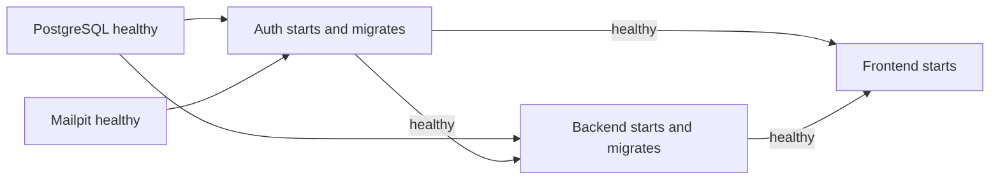

# Operations, configuration, and testing

This guide complements the [architecture overview](architecture.md), [frontend](frontend-architecture.md), [backend](backend-architecture.md), and [API reference](api.md). It describes repository commands and configuration, not a production hosting runbook.

## 1. Local lifecycle

```sh
make up
```

`make up` depends on `make init`. [`scripts/init-env.sh`](../scripts/init-env.sh) preserves an existing `.env` or creates one with restrictive umask, no-clobber behavior, and four independent 32-byte random hex secrets from openssl. Docker Compose then builds, starts in detached mode, and waits for health checks.

Open `http://localhost:8080` and the verification inbox at `http://localhost:8025`. Register, find the Mailpit message, open its link, explicitly verify, and then sign in. Mailpit captures local email rather than delivering to real inboxes.

```sh
make logs                         # Follow recent container logs
make down                         # Stop; retain the PostgreSQL volume
docker compose up -d --build --wait # Rebuild changed code/assets
```

`docker compose down -v` removes application storage; it is not a normal restart/upgrade command. Saving accounts/notes depends on retaining `postgres_data`. The repository provides no automatic backup/restore job. Changing database passwords in `.env` alone does not rotate roles in an existing volume.

## 2. Startup ordering and health



Compose has five services and a named PostgreSQL volume. PostgreSQL runs database provisioning on its first initialization. Each Go process runs its own migrations at every start, skipping recorded filenames. Auth and backend use `restart: unless-stopped`, as do PostgreSQL, Mailpit, and frontend.

Health endpoints/checks:

| Service | Check | What it proves |
| --- | --- | --- |
| postgres | `pg_isready` on localhost | PostgreSQL accepts connections |
| mailpit | `/mailpit readyz` | Mailpit's readiness check succeeds |
| auth | wget `/healthz` on 8081 | Auth responds and can ping its database |
| backend | wget `/healthz` on 8082 | Backend responds and can ping its database |
| frontend | wget `/healthz` on port 80 | nginx responds with its constant success response |

Health ordering helps initial startup. It does not make every service continuously available or automatically restart a container merely because it becomes unhealthy. Auth/backend runtime dependency failures are returned by their handlers. In particular, SMTP and backend-to-auth behavior are outside their own health endpoints.

## 3. Configuration reference

Defaults below come from [`compose.yaml`](../compose.yaml), [`.env.example`](../.env.example), and the two service entry points. The real `.env` is ignored by git/Docker context and is not reproduced here.

| Variable | Consumer | Default/requirement and meaning |
| --- | --- | --- |
| `APP_URL` | Both Go services | `http://localhost:8080`; HTTP(S) origin with no path/query/fragment/userinfo; used for origin checks and links |
| `APP_PORT` | Compose frontend mapping | 8080; maps loopback host port to nginx 80 |
| `MAILPIT_PORT` | Compose inbox mapping | 8025; Mailpit browser inbox only |
| `POSTGRES_PASSWORD` | PostgreSQL initialization | Required random admin password |
| `AUTH_DB_PASSWORD` | PostgreSQL init/auth DSN | Required; separate auth owner credential |
| `NOTES_DB_PASSWORD` | PostgreSQL init/backend DSN | Required; separate notes owner credential |
| `INTERNAL_API_KEY` | Both Go services | Required; at least 32 characters; backend-to-auth credential |
| `DATABASE_URL` | Each Go service | Required; Compose constructs its database-specific postgres DSN |
| `AUTH_URL` | Backend | `http://auth:8081`; internal auth endpoint base |
| `LISTEN_ADDR` | Each Go service | Auth `:8081`, backend `:8082`; not supplied by Compose |
| `SMTP_HOST` | Auth | mailpit |
| `SMTP_PORT` | Auth | 1025 |
| `SMTP_FROM` | Auth | hello@noteit.local; normalized/validated sender |
| `SMTP_USERNAME` | Auth | Empty; when provided requires STARTTLS and enables PLAIN auth |
| `SMTP_PASSWORD` | Auth | Empty; SMTP auth password |
| `SMTP_REQUIRE_TLS` | Auth | false; only literal `true` enables mandatory STARTTLS |
| `TEST_AUTH_DATABASE_URL` | Integration tests/local test runner | Empty by default; must refer to a dedicated test database |
| `TEST_NOTES_DATABASE_URL` | Integration tests/local test runner | Empty by default; must refer to a dedicated test database |
| `GOCACHE`, `GOMODCACHE` | Makefile/local test runner | Repository `.cache/go-build` and `.cache/go-mod` |

Changing APP_PORT also requires APP_URL to match the actual browser origin, including port. `localhost` and `127.0.0.1` are different origins for middleware checks. The frontend Mailpit anchor is hardcoded to localhost:8025; changing MAILPIT_PORT requires manually opening the new inbox URL or editing that link.

Compose does not automatically inject every `.env` variable into containers: it supplies the explicit environment mappings in compose.yaml. In particular, customizing LISTEN_ADDR through `.env` alone has no effect, and changing internal ports would also require proxy/healthcheck/client changes.

## 4. Images and network behavior

| Image/build | Implementation |
| --- | --- |
| Go service build | `golang:1.27.1-alpine`; SERVICE build arg selects cmd/auth or cmd/backend; CGO disabled; trimpath and stripped binary |
| Go runtime | `alpine:3.23`, CA certificates, non-root `noteit` user |
| Frontend | `nginx:1.28-alpine`, copied config and entire web directory |
| Database | `postgres:17-alpine` |
| Mailpit | `axllent/mailpit:v1.27.4` |
| Test runner | `golang:1.27.1-alpine`, gcc/musl for race testing, Node from Alpine |

Auth/backend containers are read-only, drop all capabilities, and use no-new-privileges. Frontend applies no-new-privileges but is not configured as read-only or a custom unprivileged container. PostgreSQL writes to its volume. Source is copied into images, not mounted for hot reload.

nginx routes `/api/auth/` before the general `/api/` prefix, blocks `/internal/`, sets Host/X-Real-IP, and clears the internal key. Original request paths are forwarded. Variable upstreams and Docker resolver `127.0.0.11` with ten-second validity permit DNS re-resolution. Maximum proxy body size is 1 MiB.

All frontend responses disable caching. CSP allows scripts/styles/connects from self and disallows images/media/objects/frames, external script execution, base URLs, and framing. Other headers include DENY framing, no-referrer, and nosniff. Access logs are disabled to avoid storing publication tokens. No compression, asset hashing, CDN policy, explicit proxy timeout settings, or HTTPS termination is configured here.

For non-local hosting, the existing design requires HTTPS ingress and matching HTTPS APP_URL for Secure cookies. External SMTP uses STARTTLS, not implicit TLS. The provided Compose dependency still starts/waits for Mailpit even if SMTP_HOST points elsewhere; altering that deployment topology requires Compose changes.

## 5. Existing automated verification

| Command | Runs | Boundary |
| --- | --- | --- |
| `make test` | `go test -race ./...`, eight Node tests | PostgreSQL lifecycle test skips unless both test DSNs exist |
| `make check` | go vet, app.js syntax, application Compose validation | Existing .env needed for required Compose substitutions |
| `make integration` | Isolated Docker PostgreSQL and test runner | No real browser/nginx/SMTP execution |
| `make integration-local` | Temporary local PostgreSQL or supplied test DSNs, Go integration package with race detector | Requires local PostgreSQL tools/permissions or dedicated test databases |
| `make fmt` | gofmt over cmd/internal/tests | Changes source formatting; not needed for documentation edits |

[`compose.test.yaml`](../compose.test.yaml) uses a separate `noteit-tests` project, hardcoded test-only credentials, PostgreSQL tmpfs storage, and the same provisioning script. Its health check additionally verifies the notes role/database. [`scripts/test-docker.sh`](../scripts/test-docker.sh) starts it with abort-on-exit and exits with the tests container status, then tears down with an EXIT/INT/TERM trap. Application volume/data is not used.

The Docker runner executes go vet, verbose uncached Go tests with the race detector, and Node tests. GitHub Actions runs `make integration` on pushes and pull requests through [`.github/workflows/test.yml`](../.github/workflows/test.yml). There is no deployment pipeline or browser test job.

The local integration script uses supplied test DSNs if both exist. Otherwise it discovers PostgreSQL binaries through pg_config, creates a temporary UTF-8 cluster, uses trust auth on a Unix socket (TCP disabled) with port number 55439, creates two test databases, and removes that cluster on exit. It runs the integration package only, unlike Docker's whole-suite runner. Test databases must be disposable; the lifecycle test writes real records and does not reset all tables afterward.

### Test coverage by source

| Tests | Covered behavior |
| --- | --- |
| `internal/auth/password_test.go` | Password round trip, wrong password, unique salts, invalid encoding |
| `internal/platform/platform_test.go` | Invalid JSON/unknown fields/size, origin/fetch-site rejection, email and token helpers |
| `internal/notes/model_test.go` | Text/tag/access limits and normalization |
| `internal/notes/auth_test.go` | Auth forwarding, unauthorized/unavailable/malformed/incomplete responses, missing cookie |
| `web/autosave.test.mjs` | Merging, serialized requests/versions, conflict preservation, failed-save recovery |
| `web/markdown.test.mjs` | Markdown features, unsafe HTML/media/link handling, large input/unclosed code |
| `tests/integration_test.go` | Real DB migrations and full account/note/publication lifecycle through handlers |

The integration suite uses real PostgreSQL plus `httptest` requests, an in-memory verification inbox, and a custom RoundTripper that invokes the auth handler in-process. It exercises the actual AuthClient and its headers/cookie handling without TCP listeners. It does not exercise nginx, Docker application service wiring, SMTPMailer, browser execution, or CSS layout.

Its lifecycle checks include verification replay/expiry/resend, account rollback after simulated mail failure, session hashing/revocation/expiry, owner isolation, invalid IDs/input, concurrent versioned writes, tags/search/pagination, all publication modes, allowlist removal, link rotation, live saved content, archive/Trash/restore, and origin/rate-limit rejection. It is one sequential lifecycle test with concurrent mutation checks, not an independent scenario database fixture for each subtest.

## 6. Manual application checks

Use the running local application for behaviors outside unit/in-process integration coverage:

1. Register and verify through the actual Mailpit inbox; confirm verification alone does not log in.
2. Create/edit a note; verify pending/saving/saved labels and persistence after reload.
3. Use tags, search, folders, and enough notes to exercise pagination.
4. Change the same note in two tabs; confirm a stale save offers draft download and server reload.
5. Interrupt connectivity while typing, then reconnect; check draft recovery and retry behavior.
6. Publish as private/restricted/public with owner, second verified account, and anonymous browsing; inspect which readers can open each link.
7. Revoke, archive, or delete a publication and reopen its URL; restore/unarchive and confirm it remains unpublished.
8. Preview HTML-looking text, unsafe links, and image Markdown; confirm text escaping and no embedded media.
9. Inspect desktop/mobile layout, keyboard focus, dialog controls, and save-status announcements.
10. Restart/rebuild without removing volumes; confirm accounts/notes and migrations remain intact.

These are a repeatable verification procedure, not a claim that those checks have already been run in this documentation task.

## 7. Troubleshooting by dependency

| Symptom | First places to inspect |
| --- | --- |
| Missing configuration/startup failure | .env generation, Compose required values, entry-point validation |
| Existing DB rejects changed password | Existing role password versus .env; init script only runs for fresh storage |
| Origin rejection | Browser origin versus APP_URL, especially port/hostname |
| Registration/resend returns 503 | Auth logs and SMTP_HOST/PORT/TLS/auth; signup may have rolled back |
| Login returns 403 | Account is unverified; Mailpit and verification flow |
| Notes return 503 while /healthz succeeds | Backend-to-auth URL/key/network; health only pings notes DB |
| Save repeatedly conflicts | Another writer or successful-but-unacknowledged save; preserve draft then fetch server note |
| Tag totals differ from active folder | Tag endpoint includes archived notes and ignores folder/search filters |
| Shared page still shows old text | Already loaded page has no polling; request again |
| Service healthy but application action fails | Health checks exclude SMTP/auth dependencies and permission/input checks |

## 8. Verification recorded for this documentation change

Source files, migrations, configuration, scripts, and tests were inspected directly. Verification on 2026-10-13 passed:

- `make test`: Go tests with the race detector and all eight JavaScript tests.
- `make check`: go vet, app.js syntax, and application Compose validation.
- `docker compose -f compose.test.yaml config --quiet`: test Compose validation.
- Local Markdown link, code-fence, and whitespace checks.

A verbose run of the integration package confirmed that `TestApplicationLifecycle` skipped because test database URLs were absent. Passing ordinary `make test` therefore does not establish PostgreSQL integration coverage. Live containers, browser interaction, and SMTP delivery were not exercised for this documentation change.

The scope of this change is documentation. It does not add runtime features, change security rules, migrate data, or claim live Docker/browser/SMTP verification.
